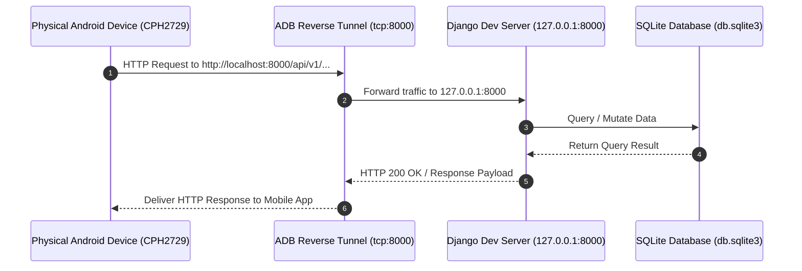

# Standard Operating Procedure (SOP)
## ZeoKash Backend Execution & Physical Device ADB Debugging

**Document ID:** SOP-ZEO-001  
**Version:** 1.0.0  
**Effective Date:** October 7, 2026  
**Target Audience:** Backend Developers, Mobile App Developers, QA Engineers  

---

## 1. Purpose & Scope
This Standard Operating Procedure defines the step-by-step instructions for launching the **ZeoKash Fintech Backend**, configuring environment paths for Android Developer Tools (ADB), connecting physical mobile devices, and routing mobile network traffic to local server endpoints via ADB reverse tunneling.

---

## 2. Prerequisites & Requirements

| Component | Minimum Requirement | Path / Location |
| :--- | :--- | :--- |
| **Python** | `3.12+` | `.\venv\Scripts\python.exe` |
| **Django Backend** | ZeoKash Core Workspace | `c:\Users\amite\zeokash_backend` |
| **Android SDK Platform-Tools** | ADB Version `1.0.41+` | `C:\Users\amite\AppData\Local\Android\Sdk\platform-tools\` |
| **Physical Device** | Android 10+ (Developer Options Enabled) | Connected via USB (MTP Mode) |

---

## 3. Request Routing & Testing Architecture



---

## 4. Step-by-Step Operating Instructions

### Step 1: Environment Path Setup (One-Time Setup)
To ensure the `adb` CLI command can be executed from any terminal, add Android `platform-tools` to your Windows User PATH environment variable.

1. Open PowerShell and run:
   ```powershell
   [Environment]::SetEnvironmentVariable(
       "Path",
       [Environment]::GetEnvironmentVariable("Path", "User") + ";C:\Users\amite\AppData\Local\Android\Sdk\platform-tools",
       "User"
   )
   ```
2. Close and reopen your terminal to apply the updated PATH variable.

---

### Step 2: Database & System Check Verification
Before launching the backend, run standard diagnostic checks and apply pending migrations:

1. Navigate to project root:
   ```powershell
   cd c:\Users\amite\zeokash_backend
   ```
2. Verify Django system checks:
   ```powershell
   .\venv\Scripts\python.exe manage.py check
   ```
3. Run database migrations:
   ```powershell
   .\venv\Scripts\python.exe manage.py migrate
   ```

---

### Step 3: Launching the Backend Server
Start the local development server on port `8000`:

```powershell
.\venv\Scripts\python.exe manage.py runserver 8000
```

> [!NOTE]
> Key Endpoints to test server health:
> - **Health Check**: `http://127.0.0.1:8000/health/`
> - **Swagger API Specs**: `http://127.0.0.1:8000/api/docs/`
> - **Admin Interface**: `http://127.0.0.1:8000/admin/`

---

### Step 4: Physical Device Connection & USB Debugging
1. On your physical Android device, navigate to **Settings > About Phone** and tap **Build Number** 7 times to unlock **Developer Options**.
2. Go to **Settings > System > Developer Options** and enable **USB Debugging**.
3. Connect the phone to your PC using a data-capable USB cable.
4. Verify connected device status via ADB:
   ```powershell
   adb devices -l
   ```
   *Expected Output:*
   ```text
   List of devices attached
   25ce2145               device product:CPH2729IN model:CPH2729 device:OP5EE3L1 transport_id:1
   ```

---

### Step 5: Configure Reverse Port Forwarding (`adb reverse`)
Enable reverse port forwarding so that requests sent by the mobile app to `localhost:8000` route directly to the Django server running on your PC:

```powershell
adb reverse tcp:8000 tcp:8000
```

> [!TIP]
> To list active reverse socket connections at any time:
> ```powershell
> adb reverse --list
> ```

---

## 5. Troubleshooting Matrix

> [!WARNING]
> If mobile app requests fail or ADB commands fail, refer to the diagnostic procedures below.

| Issue / Error | Root Cause | Corrective Action |
| :--- | :--- | :--- |
| `'adb' is not recognized` | `platform-tools` folder not present in User PATH. | Follow **Step 1** to add `platform-tools` to PATH, or use absolute path `& "$env:LOCALAPPDATA\Android\Sdk\platform-tools\adb.exe"`. |
| Device status: `unauthorized` | USB debugging RSA authorization prompt was missed or declined. | Unlock phone screen, unplug USB, plug back in, and tap **"Always allow from this computer"**. |
| Device status: `offline` | Stale ADB daemon process. | Run `adb kill-server` followed by `adb start-server`. Re-plug USB cable. |
| Mobile app gets `Network Error` | ADB reverse tunnel lost or broken. | Re-run `adb reverse tcp:8000 tcp:8000` or verify backend is listening on port `8000`. |
| HTTP 403 / CORS Error | Host header mismatch or missing origin. | Verify `.env` has `ALLOWED_HOSTS=localhost,127.0.0.1,0.0.0.0`. |

---

## 6. Verification Checklist
- [x] Django backend running (`http://127.0.0.1:8000/health/` returns HTTP 200).
- [x] `adb.exe` localized in `platform-tools`.
- [x] Physical device listed with state `device`.
- [x] Reverse port forwarding active (`tcp:8000` -> `tcp:8000`).
