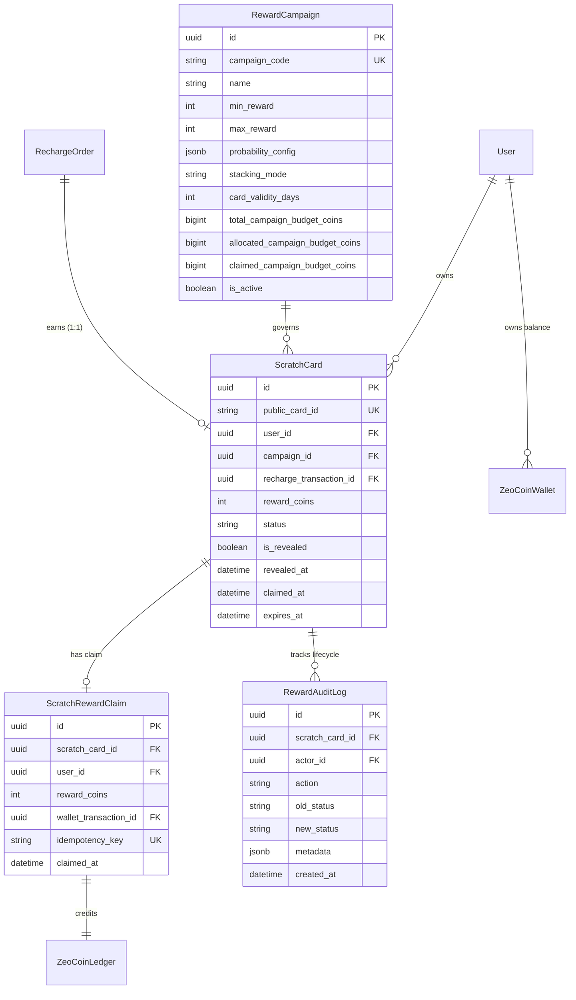

# ZeoKash — Complete Scratch & Win Rewards System Implementation Report

## Executive Summary

The production-ready **Scratch & Win Rewards System** has been fully implemented across the ZeoKash fintech ecosystem. This includes:
1. **Django REST Framework Backend**: Cryptographic reward engine, row-locked atomic claiming, idempotent card issuance, automated Celery expiration & reminders, staff analytics APIs, and complete audit logging.
2. **Flutter Mobile Application**: High-performance interactive scratch card widget (`CustomPainter` with `BlendMode.clear`), progressive reveal detection (~60% threshold), 3D coin animations, celebration confetti, My Rewards center, and seamless integration into Recharge Success and Zeo Coin Wallet screens.
3. **React Staff Admin Dashboard**: Real-time KPI cards, actual vs. target tier distribution charts, searchable/filterable Scratch Cards ledger, live campaign budget controllers, and an immutable audit log viewer.
4. **Testing & Quality Assurance**: 14/14 Django pytest integration tests passing, 5/5 Flutter unit tests passing, 0 `flutter analyze` warnings, and 0 TypeScript build errors.

---

## 1. Mathematical & Probabilistic Model

### Reward Distribution Table
The backend engine samples cryptographically secure integers using Python's `secrets` module over a discrete 10,000 weight base:

| Tier | Range | Target % | Integer Weight | Cumulative Boundary | Theoretical Avg |
|---|---|---:|---:|---:|---:|
| **Tier 1** | 1–10 Zeo Coins | 60.0% | 6,000 | 1 – 6,000 | 5.50 coins |
| **Tier 2** | 11–20 Zeo Coins | 30.0% | 3,000 | 6,001 – 9,000 | 15.50 coins |
| **Tier 3** | 21–30 Zeo Coins | 8.5% | 850 | 9,001 – 9,850 | 25.50 coins |
| **Tier 4** | 31–40 Zeo Coins | 1.0% | 100 | 9,851 – 9,950 | 35.50 coins |
| **Tier 5** | 41–50 Zeo Coins | 0.5% | 50 | 9,951 – 10,000 | 45.50 coins |
| **Total** | **1–50 Zeo Coins** | **100.0%** | **10,000** | — | **10.70 coins** |

### Conversion Rate & Unit Economics
- **Conversion Rate**: 10 Zeo Coins = ₹1.00 (₹0.10 per coin).
- **Expected Reward**: 10.70 Zeo Coins per successful eligible recharge = **₹1.07 expected cost per recharge**.
- **Wallet Redemption Cap**: Users may redeem Zeo Coins toward up to 10% of eligible transaction amounts (preserved existing restriction).
- **Stacking Rule**: Scratch Card rewards stack alongside the standard 1.5% cashback by default (`STACK_BOTH`), configurable via the Admin Portal (`SCRATCH_ONLY`, `CASHBACK_ONLY`, or `STACK_BOTH`).

---

## 2. Backend Architecture (`apps/rewards/`)

### Database Models



### Key Architectural Safeguards
1. **Hidden Reward Payload**: The `ScratchCardSerializer` dynamically redacts `reward_coins` to `null` while `status == "AVAILABLE"` to prevent inspecting coin values before scratching.
2. **Database-Level Unique Constraint**: `UniqueConstraint(fields=['recharge_transaction', 'campaign'])` guarantees no duplicate cards can be generated per recharge even under race conditions.
3. **Pessimistic Row Locking**: All reveal and claim operations execute within `transaction.atomic()` using `select_for_update()`.
4. **Recharge Reversal / Refund Handling**:
   - If an order is refunded/reversed when the card is `AVAILABLE` or `REVEALED`, the card is immediately transitioned to `VOIDED`, and allocated budget coins are returned to the campaign.
   - If the card has already been `CLAIMED`, a `CLAIMED_REWARD_REVERSAL_FLAGGED` audit entry is created for manual financial reconciliation to prevent negative balances.

---

## 3. Customer & Staff API Specifications

### Customer Endpoints (`/api/v1/rewards/`)

| Method | Endpoint | Description |
|---|---|---|
| `GET` | `/api/v1/rewards/scratch-cards/` | List customer's scratch cards (`status` filter, pagination; hides unrevealed amounts) |
| `GET` | `/api/v1/rewards/scratch-cards/{card_id}/` | Get details of a single scratch card |
| `POST` | `/api/v1/rewards/scratch-cards/{card_id}/reveal/` | Transition card to `REVEALED` and reveal predetermined reward |
| `POST` | `/api/v1/rewards/scratch-cards/{card_id}/claim/` | Atomic claim into Zeo Coin wallet and ledger |
| `GET` | `/api/v1/rewards/history/` | Paginated reward history with claimed/revealed amounts |
| `GET` | `/api/v1/rewards/summary/` | Summary metrics (cards earned, claimed, coins won, current wallet balance) |
| `GET` | `/api/v1/rewards/campaigns/active/` | Active campaign metadata, stacking rules, and terms |

### Staff Administration Endpoints (`/api/staff/rewards/`)

| Method | Endpoint | Description |
|---|---|---|
| `GET` | `/api/staff/rewards/dashboard/kpis/` | Executive KPIs, liability in INR/coins, claim rate, unit economics |
| `GET` | `/api/staff/rewards/dashboard/charts/` | 30-day activity trends (cards issued, claimed, expired) |
| `GET` | `/api/staff/rewards/cards/` | Paginated search of all cards by mobile, status, order ref |
| `GET` | `/api/staff/rewards/campaigns/` | List reward campaigns with budget allocation gauges |
| `PATCH` | `/api/staff/rewards/campaigns/{id}/` | Update campaign budget, stacking mode, or active status |
| `GET` | `/api/staff/rewards/audit-logs/` | Immutable audit log trail with actor and metadata |

---

## 4. Flutter Mobile Implementation (`features/rewards/`)

```text
lib/
├── core/routing/app_router.dart                     # Routes for rewards flow
├── features/
│   ├── payments/presentation/screens/shared/
│   │   └── payment_success_screen.dart              # Screen A: Recharge Success Reward Banner
│   ├── rewards/
│   │   ├── models/
│   │   │   ├── scratch_card_model.dart              # ScratchCard & RewardSummary models
│   │   │   └── reward_campaign_model.dart           # Campaign configuration model
│   │   ├── providers/
│   │   │   └── scratch_card_provider.dart           # Riverpod 3 NotifierProvider & async state
│   │   ├── repositories/
│   │   │   └── scratch_card_repository.dart         # Repository contract & implementation
│   │   ├── services/
│   │   │   └── scratch_card_api_service.dart        # Dio HTTP service with JWT headers
│   │   ├── widgets/
│   │   │   ├── scratch_card_widget.dart             # High-FPS finger scratch with BlendMode.clear
│   │   │   ├── reward_coin_widget.dart              # Animated 3D gold coin visual
│   │   │   ├── scratch_confetti_widget.dart         # Confetti particle burst
│   │   │   └── scratch_card_tile.dart               # Cards list item widget
│   │   └── screens/
│   │       ├── scratch_card_screen.dart             # Screen B: Scratch Card Interaction Screen
│   │       ├── scratch_reward_screen.dart           # Screen C: Reveal, Confetti & Claim Screen
│   │       └── my_rewards_screen.dart               # Screen D: Tabbed Rewards Center
│   └── zeocoins/presentation/screens/
│       └── zeocoin_wallet_screen.dart               # Screen E: Wallet entry banner & ledger badges
```

### Scratch Widget Mechanics
- **Canvas Rendering**: Uses an offscreen `saveLayer` and `BlendMode.clear` to clear the gold metallic gradient overlay following touch paths.
- **Threshold Detection**: Samples a 20x20 cell grid across the card surface. Once cleared cells exceed ~60%, the widget automatically triggers `onScratchCompleted`.
- **Reduced Motion**: Respects `MediaQuery.of(context).disableAnimations` to gracefully reveal without particle overhead when requested.

---

## 5. React Admin Portal Implementation (`admin-frontend`)

### Pages & Components
- **`src/pages/RewardsManagementPage.tsx`**:
  - **KPI Header**: Total Recharges, Cards Issued, Claim Rate, Total Coins Allocated, Outstanding INR Liability, Theoretical vs. Actual Average.
  - **Probability Distribution Breakdown**: Bar gauge comparing actual sampled distribution vs. target odds (60%, 30%, 8.5%, 1.0%, 0.5%).
  - **Scratch Cards Table**: Real-time filtering by status, search by card ID or user phone, direct transaction tracking.
  - **Campaigns Control Panel**: Budget usage progress bars and stacking rules indicator.
  - **Audit Logs View**: Filterable immutable operational logs.
- **`src/services/api.ts`**: Connected to staff backend endpoints.
- **`src/components/layout/Sidebar.tsx`**: Added "Rewards Management" navigation with `Sparkles` icon.
- **`src/App.tsx`**: Registered `/rewards` route under layout.

---

## 6. Celery Periodic Automation (`apps/rewards/tasks.py`)

1. **`expire_unclaimed_scratch_cards`**:
   - Runs daily at midnight (`crontab(hour=0, minute=0)`).
   - Transitions cards with `expires_at < now` and status `AVAILABLE` or `REVEALED` to `EXPIRED`.
   - Records `PERIODIC_BATCH_EXPIRED` in `RewardAuditLog`.
2. **`send_scratch_card_expiry_reminders`**:
   - Runs daily at 11:00 AM (`crontab(hour=11, minute=0)`).
   - Finds unclaimed cards expiring within 48 hours and sends a `REWARD_EXPIRING` notification alert.
   - Deduplicates alerts using `action_payload__card_id`.

---

## 7. Quality Assurance & Test Verification

### Backend Tests (`pytest`)
- **Suite**: 14 tests in `tests/test_rewards_distribution.py`, `tests/test_card_creation_and_claims.py`, `tests/test_recharge.py`.
- **Results**: **14 Passed in 6.63s**.
- **Coverage**:
  - Probability configuration validation (100% sum check, 1-50 bounds).
  - Statistical sampling over large draw verifying tier frequencies.
  - Card creation idempotency and unique constraints.
  - Rejection of pending and failed recharges.
  - Row-locked reveal and claim operations.
  - Ledger entry creation with `SCRATCH_CARD_REWARD`.
  - Rejection of expired and voided cards.
  - Periodic expiry and reminder Celery tasks.
  - Staff KPI and administrative endpoints.

### Flutter Tests (`flutter test`)
- **Suite**: 5 tests in `test/rewards_test.dart`.
- **Results**: **5 Passed**.
- **Analysis**: `flutter analyze` completed with **0 issues found**.

### Admin Portal Build (`vite build`)
- **Results**: **0 errors**, production bundle compiled cleanly in 5.99s.
